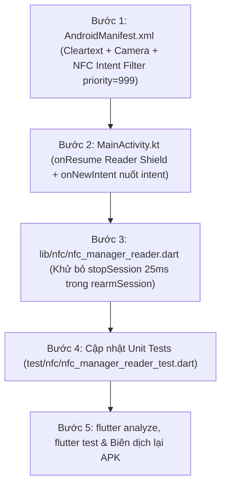

# Kế hoạch 06: Gia cố Khiên chắn NFC Toàn diện & Triệt tiêu Pop-up Hệ thống

| Mục | Giá trị |
| --- | --- |
| Tài liệu liên quan | [README.md](../README.md), [docs/00_analysis.md](00_analysis.md), [docs/03_nfc_lifecycle_plan.md](03_nfc_lifecycle_plan.md) |
| Mục tiêu | Triệt tiêu 100% hiện tượng cửa sổ "New tag scanned" (Tag Viewer hệ thống Android) nhảy ra đè ứng dụng khi quét QR hoặc chạm thẻ |
| Phạm vi can thiệp | `AndroidManifest.xml`, `MainActivity.kt`, `lib/nfc/nfc_manager_reader.dart`, `test/nfc/` |

---

## 1. Phân tích Hiện trạng & Nguyên nhân Cốt lõi

Hiện tượng: Khi mở app, quét QR hoặc chuẩn bị chạm thẻ, ứng dụng hệ thống **"New tag scanned"** (Tag Viewer) nhảy ra đè màn hình, buộc người dùng phải đóng cửa sổ ngoài rồi mới quay lại app.

| Lỗ hổng | Vị trí | Cơ chế phát sinh lỗi |
| --- | --- | --- |
| **1. Khoảng trống 25ms khi Re-arm** | [lib/nfc/nfc_manager_reader.dart](file:///d:/02.%20Project/moonkage-platform/mobile/lib/nfc/nfc_manager_reader.dart) | Hàm `rearmSession()` gọi `_manager.stopSession()` kèm chờ 25ms. Lệnh này gọi `NfcAdapter.disableReaderMode()`. Trong 25ms này, khi ReaderMode tắt, nếu thẻ ở gần cuộn cảm, hệ điều hành Android lập tức kích hoạt bộ Tag Dispatcher mặc định và mở popup ngoài. |
| **2. ReaderMode tự tắt khi `onPause`** | [MainActivity.kt](file:///d:/02.%20Project/moonkage-platform/mobile/android/app/src/main/kotlin/edu/fpt/moonkage/mobile/MainActivity.kt) | Theo tài liệu Android SDK, `enableReaderMode` tự động bị vô hiệu hóa khi Activity rơi vào `onPause()`. Khi camera (`mobile_scanner`) bật lên quét QR hoặc cấp quyền, Activity pause/resume nhưng `MainActivity.kt` chỉ có `onStart()` mà **không có `onResume()`**, khiến tầng Native không tự kích hoạt lại khiên chắn. |
| **3. Chưa đăng ký Intent Filter ưu tiên** | [AndroidManifest.xml](file:///d:/02.%20Project/moonkage-platform/mobile/android/app/src/main/AndroidManifest.xml) | Chưa khai báo `<intent-filter>` NFC với độ ưu tiên cao (`priority="999"`), khiến Android coi app là ứng dụng lạ (unknown app) và giao quyền xử lý NDEF cho Tag Viewer hệ thống. |
| **4. Thiếu cấu hình Cleartext Traffic** | [AndroidManifest.xml](file:///d:/02.%20Project/moonkage-platform/mobile/android/app/src/main/AndroidManifest.xml) | Thiếu `android:usesCleartextTraffic="true"` khiến Android 9+ chặn kết nối HTTP tới Mock Server `http://192.168.2.115:8090`. |

---

## 2. Các Bước Triển Khai Chi Tiết



### Bước 1: Gia cố cấu hình [AndroidManifest.xml](file:///d:/02.%20Project/moonkage-platform/mobile/android/app/src/main/AndroidManifest.xml)

1. Thêm `android:usesCleartextTraffic="true"` vào thẻ `<application>` để thông mạng HTTP mock server.
2. Thêm `<uses-permission android:name="android.permission.CAMERA" />` rõ ràng ở phần đầu manifest.
3. Thêm `<intent-filter android:priority="999">` cho `NDEF_DISCOVERED` (`text/plain`) và `TAG_DISCOVERED` trong thẻ `<activity>` của `MainActivity` để đón đầu và ngăn OS chuyển giao cho ứng dụng Tag Viewer.

### Bước 2: Tái kích hoạt Native Shield liên tục tại [MainActivity.kt](file:///d:/02.%20Project/moonkage-platform/mobile/android/app/src/main/kotlin/edu/fpt/moonkage/mobile/MainActivity.kt)

1. Tách hàm `enableNativeReaderShield()` bật ReaderMode với đầy đủ cờ (`NFC_A`, `B`, `F`, `V` và `FLAG_READER_NO_PLATFORM_SOUNDS`).
2. Gọi `enableNativeReaderShield()` trong cả **`onStart()`** và **`onResume()`** (bảo vệ tuyệt đối sau khi camera tắt hoặc chuyển màn hình).
3. Override **`onNewIntent(intent: Intent)`** để chặn và nuốt sạch mọi Intent NFC lạc.

### Bước 3: Khử bỏ hoàn toàn việc ngắt ReaderMode tại [lib/nfc/nfc_manager_reader.dart](file:///d:/02.%20Project/moonkage-platform/mobile/lib/nfc/nfc_manager_reader.dart)

1. Sửa hàm `rearmSession()`:
   * **Xóa bỏ hoàn toàn** `await _manager.stopSession()` và `await Future<void>.delayed(const Duration(milliseconds: 25));`.
   * Thay bằng việc gọi trực tiếp `await ensureSessionStarted(force: true);`.
   * *Nguyên lý:* Gọi `enableReaderMode` nhiều lần trên Android SDK sẽ làm mới callback mà không giải phóng quyền kiểm soát về cho hệ điều hành, bảo vệ liên tục 100% thời gian.

### Bước 4: Đồng bộ Unit Test tại [test/nfc/nfc_manager_reader_test.dart](file:///d:/02.%20Project/moonkage-platform/mobile/test/nfc/nfc_manager_reader_test.dart)

1. Cập nhật nhóm test `rearmSession`:
   * Xác nhận `_manager.stopSession()` **không** bị gọi (`verifyNever(() => manager.stopSession())`).
   * Xác nhận `_manager.startSession(...)` được gọi làm mới với đầy đủ polling options.

### Bước 5: Kiểm thử chất lượng và Đóng gói bản build APK

1. Chạy `dart format .` và `flutter analyze` đảm bảo 0 issues.
2. Chạy `flutter test` đảm bảo toàn bộ **86/86 test cases** pass.
3. Build lại file APK:

   ```powershell
   flutter build apk --dart-define-from-file=env/mock.json
   ```

---

## 3. Tiêu chí Nghiệm thu (Acceptance Criteria)

1. ✅ **Không còn pop-up hệ thống:** Mở app, quét QR, hoặc áp thẻ trước khi vào màn Chạm thẻ $\rightarrow$ Điện thoại hoàn toàn im lặng, không có cửa sổ "New tag scanned" nào của Android nhảy ra.
2. ✅ **Đọc thẻ tức thì:** Vào màn Chạm thẻ, áp thẻ vào lưng máy $\rightarrow$ Nhận diện ngay lập tức, rung Haptic mượt mà và chuyển sang màn Xác nhận.
3. ✅ **Kiểm thử tự động:** 86/86 unit/widget tests pass 100%, `flutter analyze` không có cảnh báo.
4. ✅ **File APK hoàn tất:** Xuất file `app-release.apk` mới sẵn sàng cài đặt qua ADB.
